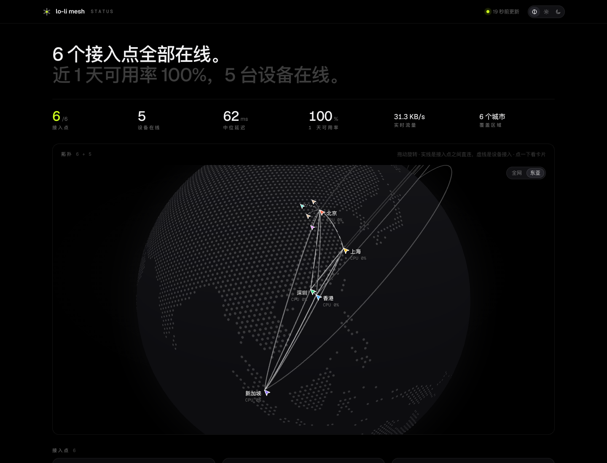
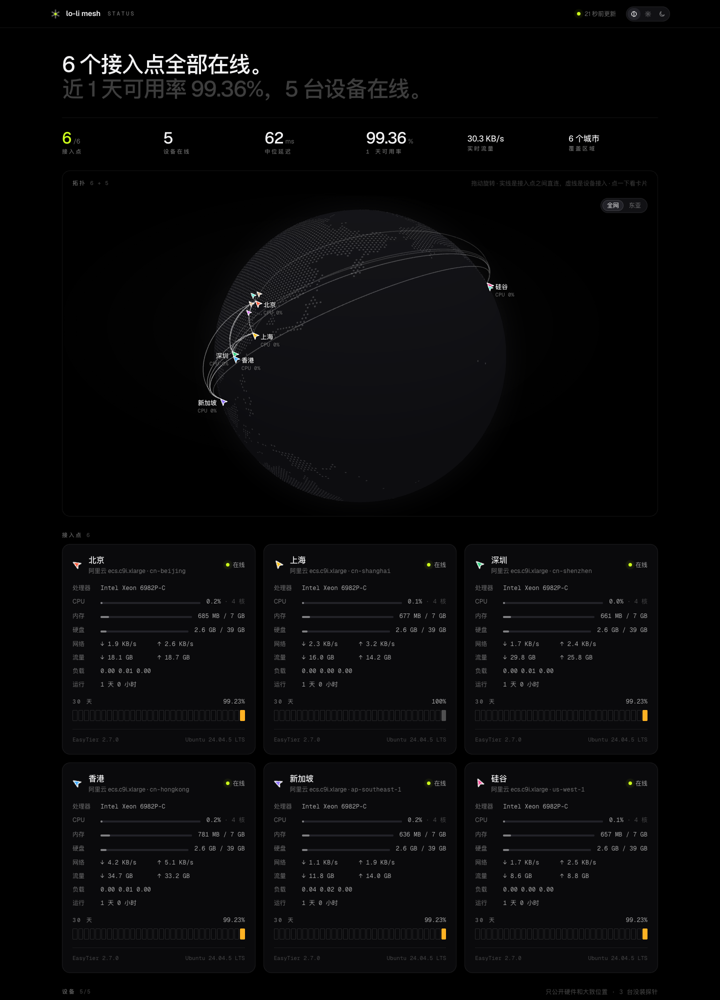

<div align="center">

<a href="https://join.edge.lo-li.co"></a>

# lolinet

### Your machines on one encrypted network. On relays you own.

**A self-hosted mesh network for vibe coding, built on EasyTier.**<br>
Laptops, NAS boxes and dev servers join with one command and a pairing code,<br>
then reach each other directly or through your relays, whichever is faster.

[](https://github.com/prnake/lolinet/actions/workflows/build.yml) [](https://github.com/prnake/lolinet/releases) [](LICENSE) [](https://github.com/EasyTier/EasyTier)<br>
  

**[Live network](https://join.edge.lo-li.co)** &nbsp;·&nbsp; **[Self-hosting](docs/self-hosting.md)** &nbsp;·&nbsp; **[Reference](docs/reference.md)** &nbsp;·&nbsp; **[Architecture](docs/architecture.md)** &nbsp;·&nbsp; **[Releases](https://github.com/prnake/lolinet/releases)** &nbsp;·&nbsp; **English** · [简体中文](README.zh-CN.md)

<br>



</div>

<br>

## Is lolinet for you?

lolinet puts the computers you code on (a laptop, a NAS, cloud boxes, a server at home) on one private network, the way Tailscale does. The difference is that the relays, the keys and the console are all yours:

- **Join with one line.** `curl <join site>/i | sudo sh -s <pairing code>` installs the client, a background service and auto-upgrade. A code works once, for 15 minutes. The same line without a code installs or upgrades the client on a device that is already in.
- **No shared network secret.** Every device gets its own credential from your console. A credential lasts at most a year, can't be reused, and can be revoked on its own. A device's config holds no network secret.
- **Built for cross-border links.** Devices reach relays over WSS on port 443 with a TLS server name you choose. TCP rides inside KCP, so ISP shaping of long TCP flows doesn't slow it down. Traffic takes the lowest-latency path across a full mesh of relays.
- **One small binary.** `lolinet` has patched EasyTier built in. It installs the launchd or systemd service, shows which peers are direct and which are relayed, and upgrades itself only after checking the sha256 and test-running the new version.

It's for you if your machines sit on several networks (home, office, cloud, inside and outside mainland China) and you're willing to run a few small relays and one Cloudflare Worker. If you want a hosted service with nothing to run, use Tailscale or plain EasyTier.

Devices run macOS (Apple silicon and Intel) or Linux (x86_64 and arm64, with systemd). A relay is any Linux host with a public address.

See it live at **[join.edge.lo-li.co](https://join.edge.lo-li.co)**, the author's own network: open it in a browser for the public probe, or `curl` it for the install command.

## Quick start

These three steps join a network that already exists. To set up your own network first, see **[Self-hosting](docs/self-hosting.md)**.

**1 · Get a pairing code.** The person who runs the network creates one, either on the **Pair** page of the [local console](docs/console.md) or from the terminal:

```sh
uv run scripts/pair.py new --name laptop --ip 10.188.16.11
```

**2 · Join.** On the device:

```sh
curl -fsSL https://join.edge.example.com/i | sudo sh -s XXXX-XXXX-XXXX
```

<sub>The script downloads `lolinet` from the latest GitHub Release (or the join site's `dl/` if GitHub is unreachable or slow), checks its sha256 and test-runs it, then redeems the code, decrypts the config on the device, installs `lolinet` to `/usr/local/bin`, registers the launchd or systemd service, and turns on auto-upgrade (every 6 hours). It also installs the public probe, which reports only hardware and a rough location; pair with `--no-probe` to leave it out. Once a [lolidesk](docs/lolidesk.md) release is published, it installs `lolidesk` and `lolidesk-host` too, without starting the host. On Linux it needs systemd. For Docker or a NAS without sudo, see [devices without systemd](docs/self-hosting.md#devices-without-systemd).</sub>

Already in, or installed by an older script? Run it without a code. It uses the config already on the machine, installs or upgrades `lolinet`, and does nothing if it is current:

```sh
curl -fsSL https://join.edge.example.com/i | sudo sh       # install or upgrade
curl -fsSL https://join.edge.example.com/i | sh -s check   # only say whether it would, no root
```

**3 · Check.** Run `lolinet`. It shows the service, this machine, the days left on its credential, and every relay and device: direct or relayed, latency and loss.

Everything else is in the terminal too:

```sh
lolinet peers | routes                # easytier-cli peer / route
lolinet logs -f                       # kernel log, /var/log/lolinet/easytier.log
sudo lolinet restart
sudo lolinet upgrade                  # --check only looks, --dry-run downloads and verifies without switching
sudo lolinet up --auto-upgrade off    # turn auto-upgrade off (on turns it back on)
sudo lolinet down                     # stop and remove the service; config and binary stay
lolinet cli …                         # stock easytier-cli (lolinet core … is easytier-core)
```

## How it fits together

The core is [EasyTier](https://github.com/EasyTier/EasyTier) with three small patches. Everything around it (the CLI, join site, pairing, console and public probe) was vibe coded with Claude.

```
device ──wss :443, your SNI──▶ relay ◀── tcp / udp, every pair ──▶ relay ◀──▶ relay …
  │                              ▲
  │                              └─ the issuer relay also runs the easytier-web console (overlay only)
  │
  └─ curl https://<join site>/i | sudo sh -s <pairing code>
       └─ join site on Cloudflare Workers:
            one-time encrypted configs (KV) · packages and upgrade manifest (R2) · public probe (Durable Object)
```

| Piece | Runs on | Does |
| :-- | :-- | :-- |
| **`lolinet`** | every device | EasyTier and a small CLI in one binary: service, status, upgrade |
| **Relays** | Linux hosts with public addresses | EasyTier nodes in secure and private mode, connected to each other in a full mesh. One of them, the *issuer*, runs the easytier-web console that signs credentials |
| **Join site** | Cloudflare Workers, KV, R2, Durable Objects | Redeems pairing codes, serves packages and the upgrade manifest, collects and shows the public probe |
| **Admin scripts** | your machine | Sign credentials, issue pairing codes, revoke, deploy the join site |
| **Local console** | your machine, `127.0.0.1:10188` | Topology, latency, credentials and pairing in the browser |

The details are in [Architecture](docs/architecture.md).

## What it does

### Pairing and credentials

`scripts/pair.py` asks your console for a new credential, renders the device's EasyTier config, and encrypts it with the pairing code. The device fetches the ciphertext and decrypts it locally with `openssl`.

| | |
| :-- | :-- |
| **The Worker sees ciphertext only** | PBKDF2-SHA256 with 200,000 rounds and AES-256-CBC, in the format `openssl enc` reads. The Worker files the ciphertext under a hash of the code and never sees the code itself |
| **One time** | The ciphertext stays in Workers KV for 15 minutes and is deleted on the first fetch. Each IP gets 20 tries per 10 minutes |
| **A credential per device** | EasyTier's secure mode: one credential per device, signed by the console, valid up to a year and not reusable |
| **Revoke one device** | `uv run scripts/revoke.py laptop -`, or the **Credentials** page of the local console. The rest of the network is untouched |

### Transport

| | |
| :-- | :-- |
| **WSS on 443, with your SNI** | A patch lets EasyTier's TLS ClientHello carry the server name you choose (`?sni=` on the peer URL, or `ET_WSS_SNI`). Every CI build starts a fake relay with `easytier/check_sni.py` and checks it |
| **KCP proxy** | TCP flows travel inside KCP over UDP, around ISP shaping of long TCP flows |
| **Latency first** | Devices route by the network-wide latency table, through the nearest relay when that is faster than a direct path |
| **Relay mesh** | Every relay connects to every other relay over TCP and UDP |

### One binary

`lolinet` is EasyTier and its own CLI compiled together. Like busybox, it decides what to be from `argv[0]`: called `easytier-core` or `easytier-cli`, it's the stock tool. On Linux it's a static musl binary, so it also runs on routers and in containers. CI rejects a build over 32 MiB (14 MiB packaged).

`sudo lolinet up` installs it as a LaunchDaemon on macOS or a systemd unit on Linux, with the admin port bound to `127.0.0.1:15888`. It also takes over devices that an earlier join script set up with `easytier-core`: it removes the old service, copies the old config, and links the old binary paths to `lolinet`.

### Auto-upgrade

| | |
| :-- | :-- |
| **Manifest** | `lolinet.json` names the version devices should run, with each platform's file and sha256. If the local version differs, the device switches, so publishing an old version again rolls back |
| **Sources** | Whichever `install.sh` downloaded from: GitHub Releases (`github:prnake/lolinet`), or the join site's `dl/lolinet.json` when GitHub was out of reach. Or any manifest URL with `--upgrade-source` |
| **Three checks** | The download comes through the system's curl, its sha256 must match, and the new binary must run and report the manifest's version. Only then is `/usr/local/bin/lolinet` replaced atomically and the service restarted. The probe's `reporter.py` and any installed lolidesk binaries are updated the same way |
| **Quiet** | Runs every 6 hours and writes a log line only when it switches versions or fails. `lolinet status` shows whether it is on |

### Local console

A React app and a small agent that needs only the Python standard library. The agent reads the local EasyTier node through `easytier-cli -o json` and puts it together with your console's credential list. Pages: an overview with the topology on a map, the path your traffic actually takes and the latency matrix; nodes; credentials with days left; and pairing in three steps. The agent listens on loopback only, strips every secret field before the browser sees it, and turns read-only when you share it on a LAN. See [Local console](docs/console.md).

### Public probe

Relays and devices send HMAC-signed reports to the join site, and its home page shows the network's health without naming anything: relays appear as a city and an instance type, devices as hardware and a rough location. Relays report load, traffic and relay-to-relay latency every 30 seconds; devices send a heartbeat every 60 seconds.



### lolidesk

A remote terminal and remote desktop that run over the network, shipped separately from `lolinet`. Terminal sessions live on the host, so a dropped connection loses nothing and several clients can watch one session. On a macOS host, the desktop streams hardware-encoded H.264 over QUIC datagrams. One QUIC connection carries everything; the host's certificate is pinned on first use. See [lolidesk](docs/lolidesk.md).

## What's in this repository

| Path | Contents |
| :-- | :-- |
| [`lolinet/`](lolinet/README.md) | Source of the `lolinet` CLI, `build.sh`, and the release manifest generator |
| `easytier/`, `patches/` | The pinned EasyTier version, the three patches, and the checks that prove them |
| `join/` | The join site: Cloudflare Worker, `install.sh`, `deploy.py` |
| `scripts/` | `pair.py` issues pairing codes, `revoke.py` revokes, `device_config.py` renders configs |
| `probe/` | The public probe reporter (Python standard library only) and its service files |
| [`web/`](web/README.md) | The local console, the public probe page, and the console's agent |
| [`desk/`](desk/README.md) | lolidesk, a Rust workspace |
| [`nodes.example.yaml`](nodes.example.yaml) | Template for your node list |

## Documentation

| | |
| :-- | :-- |
| **[Self-hosting](docs/self-hosting.md)** | Relays, the join site, packages, adding and revoking devices, releasing |
| **[Reference](docs/reference.md)** | CLI, `nodes.yaml`, environment variables, files, ports, join-site endpoints, release format |
| **[Architecture](docs/architecture.md)** | How the pieces work: the binary, the patches, pairing, upgrades, the probe |
| **[Local console](docs/console.md)** | The browser console, its agent, and the public probe page |
| **[lolidesk](docs/lolidesk.md)** | Remote terminal and desktop over the network |
| **[Catseye](web/DESIGN.md)** | The design language of the console and probe (in Chinese) |
| **[Contributing](CONTRIBUTING.md)** | Building, testing and sending changes |

## Security

**This repository holds no secrets.** The network secret, credential keys, the console password and the probe master key are generated when you deploy, and live only in `$LOLINET_HOME/state/` (mode 600) and in Worker secrets.

Here is everything that leaves your machines for the join site:

- **Pairing:** an encrypted device config, for at most 15 minutes.
- **Probe, relays:** CPU model, OS and EasyTier version, load, memory, disk, traffic, uptime, and latency to the other relays and to devices (by anonymous id). Relay names are used only to check signatures; the page shows region codes.
- **Probe, devices:** model, CPU, memory, total storage, OS, architecture, and a city or "near <relay city>", under an anonymous id. No hostname, address, serial number or load. Pair with `--no-probe` to send nothing.

To report a vulnerability, see [SECURITY.md](SECURITY.md).

## Contributing

Bug reports, questions and pull requests are welcome on GitHub; see [CONTRIBUTING.md](CONTRIBUTING.md). Every change goes through a pull request, and CI (`build`, `desk`, `web`) must pass before it merges.

## License

[LGPL-3.0](LICENSE), the same as EasyTier. `lolinet` compiles EasyTier into its binary, and the patches change EasyTier's source.

lolinet is an independent project. It is not affiliated with the EasyTier project or with Tailscale.
