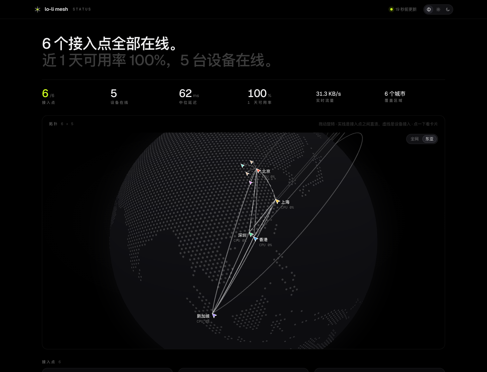
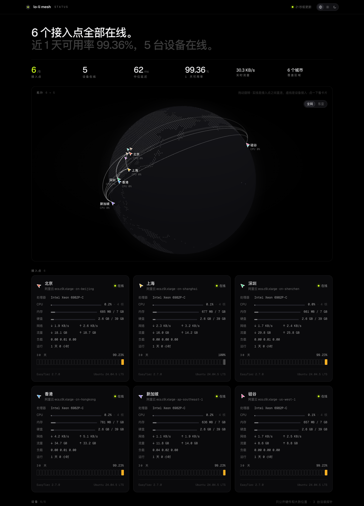

<div align="center">

<a href="https://join.edge.lo-li.co"></a>

# lolinet

### 你的机器，一张加密网，跑在你自己的 relay 上。

**基于 EasyTier 的 vibe coding 端到端加密网络，自己部署。**<br>
电脑、NAS、服务器拿一个配对码、一行命令入网，<br>
之后彼此直连或经你的 relay 中转，哪条快走哪条。

[](https://github.com/prnake/lolinet/actions/workflows/build.yml) [](https://github.com/prnake/lolinet/releases) [](LICENSE) [](https://github.com/EasyTier/EasyTier)<br>
  

**[线上例子](https://join.edge.lo-li.co)** &nbsp;·&nbsp; **[自己搭一套（英文）](docs/self-hosting.md)** &nbsp;·&nbsp; **[完整参考（英文）](docs/reference.md)** &nbsp;·&nbsp; **[架构（英文）](docs/architecture.md)** &nbsp;·&nbsp; **[Releases](https://github.com/prnake/lolinet/releases)** &nbsp;·&nbsp; [English](README.md) · **简体中文**

<br>



</div>

<br>

## lolinet 适合你吗？

lolinet 把你写代码用的机器（笔记本、NAS、云上的机器、家里的服务器）放进同一张私有网络，和 Tailscale 一个思路。不同的是 relay、密钥、控制台都在你自己手里：

- **一行命令入网。** `curl <准入站>/i | sudo sh -s <配对码>` 装好客户端、后台服务和自动升级。配对码 15 分钟内有效，只能用一次。已经入网的设备，同一行不带配对码就是装上或升级客户端。
- **没有共享的网络密钥。** 每台设备一条控制台签发的凭据，最长 1 年、不可复用，可以单独吊销。设备配置里没有 network secret。
- **为跨境链路做的。** 设备经 wss 443 连 relay，TLS 的 SNI 由你定。TCP 包进 KCP 走 UDP，绕开运营商对长 TCP 流的整形。按全网延迟表选路，relay 之间全互联。
- **一个小二进制。** `lolinet` 里编进了打过补丁的 EasyTier。它负责装 launchd / systemd 服务，告诉你哪些节点是直连、哪些是中转；自动升级前先校验 sha256，再试跑一次新版本。

如果你的机器分散在好几张网里（家里、公司、云上、境内境外），又愿意开几台小 relay、部署一个 Cloudflare Worker，它就适合你。想要什么都不用运维的托管服务，用 Tailscale 或原版 EasyTier 就行。

设备支持 macOS（Apple 芯片和 Intel）和 Linux（x86_64 和 arm64，要有 systemd）。relay 是任何有公网地址的 Linux 机器。

线上例子是作者自己的网络 **[join.edge.lo-li.co](https://join.edge.lo-li.co)**：浏览器打开是公开探针，`curl` 打开是安装命令。

## 快速开始

下面三步是加入一张已有的网络。想先搭自己的网络，看 **[自己搭一套](docs/self-hosting.md)**。

**1 · 拿配对码。** 管这张网的人在[本地控制台](docs/console.md)的 **配对** 页生成，或者在命令行里：

```sh
uv run scripts/pair.py new --name laptop --ip 10.188.16.11
```

**2 · 入网。** 在设备上执行：

```sh
curl -fsSL https://join.edge.example.com/i | sudo sh -s XXXX-XXXX-XXXX
```

<sub>脚本先从 GitHub 最新的 Release 下载 `lolinet`（连不上或太慢就用准入站的 `dl/`），校验 sha256 并试跑一次，再兑换配对码，在设备上解密配置，把 `lolinet` 装到 `/usr/local/bin`，注册 launchd / systemd 服务，并打开自动升级（每 6 小时检查一次）。默认还会装公开探针，它只报硬件和大致位置；配对时加 `--no-probe` 就不装。发布过 [lolidesk](docs/lolidesk.md) 之后，也会装 `lolidesk`，但不启动主机。Linux 上需要 systemd。Docker 和没有 sudo 的 NAS 见[没有 systemd 的设备](docs/self-hosting.md#devices-without-systemd)。</sub>

已经入网，或者是旧脚本装的？不带配对码再跑一次。它用本机现有的配置装上或升级 `lolinet`，已是最新就什么都不动：

```sh
curl -fsSL https://join.edge.example.com/i | sudo sh       # 装上或升级
curl -fsSL https://join.edge.example.com/i | sh -s check   # 只看要不要装，不要 root
```

**3 · 看状态。** 运行 `lolinet`。它会列出服务状态、本机、凭据剩余天数，以及每个接入点和设备：直连还是中转、延迟、丢包。

其他操作也都在命令行里：

```sh
lolinet peers | routes                # easytier-cli peer / route
lolinet logs -f                       # 内核日志 /var/log/lolinet/easytier.log
sudo lolinet restart
sudo lolinet upgrade                  # --check 只看，--dry-run 下载校验但不换
sudo lolinet up --auto-upgrade off    # 关掉自动升级（on 重新打开）
sudo lolinet down                     # 停掉并卸载服务，配置和二进制留着
lolinet cli …                         # 原版 easytier-cli（lolinet core … 是 easytier-core）
```

## 怎么连起来的

内核是 [EasyTier](https://github.com/EasyTier/EasyTier)，打了三个小补丁。外面这层（命令行、准入站、配对、控制台、公开探针）是和 Claude 一起 vibe coding 写出来的。

```
设备 ──wss 443，自定义 SNI──▶ relay ◀── tcp / udp 两两互联 ──▶ relay ◀──▶ relay …
  │                              ▲
  │                              └─ 签发 relay 上还跑着 easytier-web 控制台（只在 overlay 上）
  │
  └─ curl https://<准入站>/i | sudo sh -s <配对码>
       └─ 准入站，跑在 Cloudflare Workers 上：
            一次性的加密配置（KV）· 安装包和升级清单（R2）· 公开探针（Durable Object）
```

| 组件 | 跑在哪 | 做什么 |
| :-- | :-- | :-- |
| **`lolinet`** | 每台设备 | EasyTier 和一个小命令行编在一起：服务、状态、升级 |
| **relay** | 有公网地址的 Linux 机器 | EasyTier 节点，开 secure mode 和 private mode，两两互联。其中一台是签发 relay，跑签凭据的 easytier-web 控制台 |
| **准入站** | Cloudflare Workers、KV、R2、Durable Objects | 兑换配对码，分发安装包和升级清单，收集并展示公开探针 |
| **管理脚本** | 你自己的电脑 | 签凭据、出配对码、吊销、部署准入站 |
| **本地控制台** | 你自己的电脑，`127.0.0.1:10188` | 在浏览器里看拓扑、延迟、凭据，做配对 |

细节见[架构（英文）](docs/architecture.md)。

## 它能做什么

### 配对和凭据

`scripts/pair.py` 向控制台要一条新凭据，渲染出设备的 EasyTier 配置，再用配对码加密。设备取回密文，用 `openssl` 在本地解密。

| | |
| :-- | :-- |
| **Worker 只碰得到密文** | PBKDF2-SHA256 20 万轮 + AES-256-CBC，和 `openssl enc` 兼容。Worker 按配对码的哈希存密文，拿不到配对码本身 |
| **一次性** | 密文在 Workers KV 里放 15 分钟，第一次取走就删。每个 IP 每 10 分钟最多试 20 次 |
| **一台设备一条凭据** | EasyTier 的 secure mode：控制台给每台设备签一条凭据，最长 1 年、不可复用 |
| **单独吊销** | `uv run scripts/revoke.py laptop -`，或者在本地控制台的 **凭据** 页操作。网里其他设备不受影响 |
| **成员邀请成员** | 任何一台设备上 `lolinet invite`，经 overlay 问[管理面](docs/console.md#manager-on-the-issuer-relay)要配对码：不要控制台账号，地址按机器种类从地址池里分。谁能邀请什么、多久几次由策略决定 |

### 传输

| | |
| :-- | :-- |
| **wss 443，自定义 SNI** | 补丁让 EasyTier 的 TLS ClientHello 带上你指定的 SNI（peer URL 上的 `?sni=`，或者环境变量 `ET_WSS_SNI`）。CI 每次编完都用 `easytier/check_sni.py` 起一个假 relay 实测 |
| **KCP 代理** | TCP 流包进 KCP 走 UDP，绕开运营商对长 TCP 流的整形 |
| **延迟优先** | 设备按全网延迟表选路，经最近的 relay 中转比直连快时就走中转 |
| **relay 全互联** | 每台 relay 和其他每台都用 TCP 和 UDP 连着 |

### 一个二进制

`lolinet` 是 EasyTier 和自己的命令行编在一起的一个二进制。它像 busybox 那样按 `argv[0]` 决定自己是谁：叫 `easytier-core` 或 `easytier-cli` 时就是原版工具。Linux 上是 musl 静态链接，路由器和容器里也能直接跑。CI 会拒掉超过 32 MiB（打包后 14 MiB）的构建。

`sudo lolinet up` 把它装成 macOS 的 LaunchDaemon 或 Linux 的 systemd 服务，管理口只听 `127.0.0.1:15888`。以前的 join 脚本用 `easytier-core` 装的设备，它也会接管：撤掉旧服务，拷过旧配置，把旧路径的二进制换成指向 `lolinet` 的链接。

### 无 TUN 模式和出口节点

`sudo lolinet up --userspace` 不建 TUN 网卡也能入网：本机程序经 `127.0.0.1:18080` 的 SOCKS5 进网，发到本机 overlay 地址的连接会转给 `127.0.0.1`。容器里能用，mihomo 或别的 VPN 已经占着 TUN 时也能用。

`sudo lolinet exit on` 把这台的网络借给网里其他机器：端口 `10180` 上的 SOCKS5，TCP 和 UDP 都支持，只有 overlay 里连得到。它不让人打回环、云元数据，也不让人打私网地址（加 `--lan` 才放开）。浏览器、`curl --socks5-hostname` 或 mihomo 的规则都可以指向它。

**手机和 mihomo。** 手机不用再开第二个 VPN，经 mihomo 进网：`lolinet invite --kind phone` 给一个链接，手机浏览器里用配对码解开一份 mihomo 配置，里面一条 WireGuard 出站连签发 relay，只走网内地址。哪些拒绝、哪些直连、哪些经哪台出口出去，都在管理面集中定，经内网下发；`lolinet mihomo` 给电脑出同样的配置。

### 自动升级

| | |
| :-- | :-- |
| **发布清单** | `lolinet.json` 写的是设备应该跑的版本，以及每个平台的文件名和 sha256。本机版本和它不一样就换，所以把旧版本重新发布一次就是回退 |
| **来源** | `install.sh` 从哪里下载成功就跟哪里：GitHub Releases（`github:prnake/lolinet`），GitHub 连不上时是准入站的 `dl/lolinet.json`。也可以用 `--upgrade-source` 指定任何清单 URL |
| **过三关** | 用系统 curl 下载，sha256 要和清单一致，新二进制要能跑起来并报出清单里的版本。三关都过了，才原子地换掉 `/usr/local/bin/lolinet` 并重启服务。设备的探针编在 `lolinet` 里，跟着一起换；装了的 lolidesk 也一样换 |
| **不吵** | 每 6 小时跑一次，只有换了版本或出错时才写日志。`lolinet status` 能看到它开没开 |

### 本地控制台

一个 React 前端，加一个只用 Python 标准库的 agent。agent 通过 `easytier-cli -o json` 读本机的 EasyTier 节点，再和控制台的凭据列表合在一起。页面有：总览（地图上的拓扑、本机流量实际走的路、延迟矩阵）、节点、凭据（剩余天数）、三步配对。agent 只听回环地址，控制台返回的密钥字段在交给浏览器前一律删掉，开到局域网上时自动变成只读。详见[本地控制台（英文）](docs/console.md)。

### 公开探针

relay 和设备签名（HMAC）后把状态报给准入站，准入站首页展示整张网的状况，但不出现任何名字：relay 只显示城市和规格，设备只显示硬件和大致位置。relay 每 30 秒报一次负载、流量和 relay 之间的延迟，设备每 60 秒一次心跳。



### lolidesk

跑在这张网里的远程终端和远程桌面，和 `lolinet` 分开发包。终端会话在主机上，跑在 Ghostty 的终端核心（libghostty-vt）里，主机把屏幕同步给每个客户端。断线不丢，主机重启后会话带着历史回来，多个客户端可以同看一个会话，新会话可以直接起一个 coding agent。主机是 macOS 时，桌面画面用硬件编码的 H.264，经 QUIC datagram 传，分辨率、帧率和画质自己选。图形客户端用 [GPUI](https://github.com/zed-industries/zed) 写，还能用配对码把这台 Mac 加进网、列出各节点和延迟、邀请别的电脑或手机（手机扫二维码）、开关出口节点，并一步步带你开好 macOS 的两个授权。另有命令行客户端。网里任何一台机器上的 agent 都能经 `lolidesk mcp <主机>`（一个 MCP 服务）用那台的屏幕和键鼠，用的是远程桌面那份 macOS 授权，不用再授权；有人正在用这台电脑时，agent 的输入先等着。所有东西走一条 QUIC 连接，主机证书第一次连上时记住，之后钉扎。电脑之间要先配对：请求一次、对方同意，或者用配对码、分享链接；每台配对过的设备有自己的钥匙，主机列得出它最近什么时候连过，可以单独吊销。详见 [lolidesk（英文）](docs/lolidesk.md)。

## 仓库里有什么

| 路径 | 内容 |
| :-- | :-- |
| [`lolinet/`](lolinet/README.md) | `lolinet` 命令行的源码、`build.sh`、发布清单生成脚本 |
| `easytier/`、`patches/` | 钉住的 EasyTier 版本、三个补丁、实测脚本 |
| `join/` | 准入站：Cloudflare Worker、`install.sh`、`deploy.py` |
| `scripts/` | `pair.py` 出配对码，`revoke.py` 吊销，`device_config.py` 渲染配置 |
| `probe/` | relay 的公开探针上报（只用 Python 标准库）。设备的探针编在 `lolinet` 里（`lolinet probe`，格式和签名相同） |
| [`web/`](web/README.md) | 本地控制台、公开探针页面、控制台的 agent |
| [`desk/`](desk/README.md) | lolidesk，Rust 工作区：主机、图形客户端（GPUI）和命令行 |
| [`nodes.example.yaml`](nodes.example.yaml) | 节点清单模板 |

## 文档

| | |
| :-- | :-- |
| **[自己搭一套](docs/self-hosting.md)** | relay、准入站、安装包、加设备和吊销、发版（英文） |
| **[完整参考](docs/reference.md)** | 命令行、`nodes.yaml`、环境变量、文件、端口、准入站接口、发布格式（英文） |
| **[架构](docs/architecture.md)** | 各部分怎么做的：二进制、补丁、配对、升级、探针（英文） |
| **[设计](docs/design.md)** | 往哪儿走：服务器、电脑和手机；出口节点、邀请、computer use、mihomo（英文） |
| **[本地控制台](docs/console.md)** | 浏览器控制台、agent 和公开探针页面（英文） |
| **[lolidesk](docs/lolidesk.md)** | 网里的远程终端和远程桌面（英文） |
| **[猫眼](web/DESIGN.md)** | 控制台和探针的设计语言 |
| **[参与开发](CONTRIBUTING.md)** | 构建、测试、提交改动（英文） |

## 安全

**仓库里没有任何密钥。** network secret、凭据私钥、控制台密码、探针主密钥都是部署时生成的，只存在 `$LOLINET_HOME/state/`（600 权限）和 Worker secret 里。

离开你的机器、交给准入站的只有这些：

- **配对：** 一份加密的设备配置，最多放 15 分钟。
- **探针，relay：** 处理器型号、系统和 EasyTier 版本、负载、内存、硬盘、流量、运行时间，以及到其他 relay 和到设备（匿名 id）的延迟。relay 名字只用来验签，页面上显示区域代码。
- **探针，设备：** 型号、处理器、内存、存储总量、系统、架构，以及一个城市或「<relay 城市>附近」，用匿名 id 上报。不报主机名、地址、序列号和负载。配对时加 `--no-probe` 就什么都不报。

报告安全问题见 [SECURITY.md](SECURITY.md)。

## 参与开发

欢迎在 GitHub 上提 bug、提问题、开 PR，先看 [CONTRIBUTING.md](CONTRIBUTING.md)。所有改动都走 PR，CI（`build`、`desk`、`web`）通过后才合并。

## 许可

[LGPL-3.0](LICENSE)，和 EasyTier 一致。`lolinet` 把 EasyTier 编进了自己的二进制，补丁也是改的 EasyTier 源码。

lolinet 是独立项目，和 EasyTier 项目、Tailscale 都没有关系。
