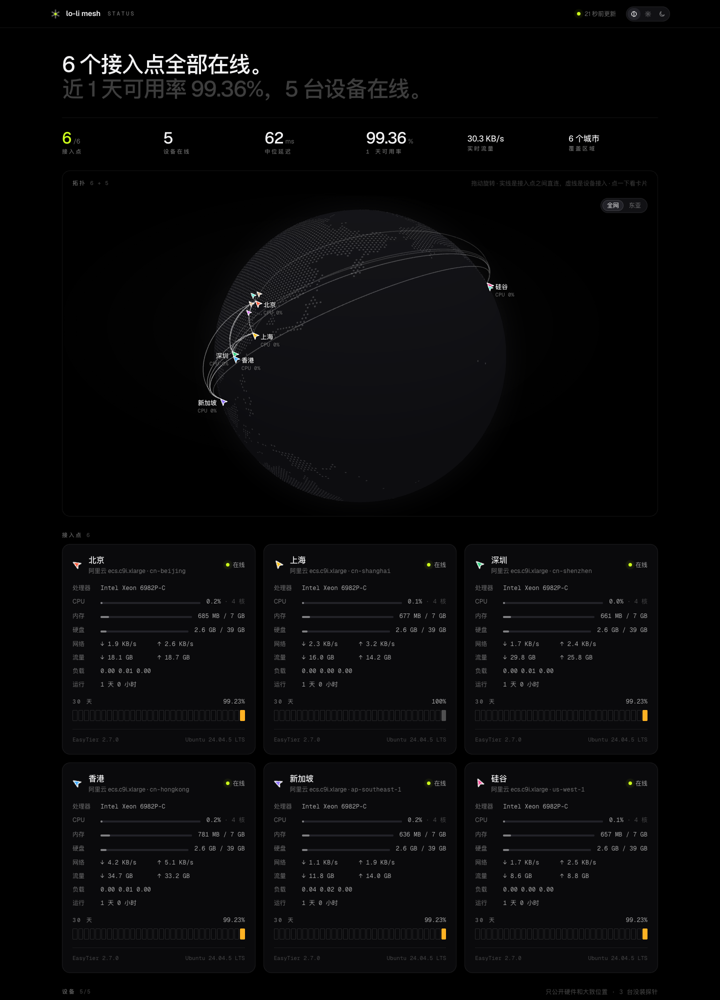

# Local console and public probe

EasyTier's own console, `easytier-web`, manages credentials and members. It doesn't show how the network is connected right now. The local console puts both in one place: the topology and latency your own kernel sees, the console's credentials, and the pairing flow. Its look follows the [Catseye design language (Chinese)](../web/DESIGN.md).

The public probe page uses the same components in a second build, served on the join site's home page.



## How it fits together

```
browser ──http──▶ agent 127.0.0.1:10188 ─┬─ easytier-cli -o json  node / peer / route / peer-center ─▶ local easytier-core
 (React)                                 ├─ /api/v1/* reverse proxy ─(TUN, or SOCKS5)─▶ console network.console (easytier-web)
                                         └─ /api/mesh/pair ─▶ uv run scripts/pair.py (sign credential, encrypt, store in KV)
```

The agent (`web/agent/mesh_agent.py`) uses only the Python standard library. The 3.9 that ships with macOS is enough, and it runs on a relay as is.

## Pages

| Page | Data | What it shows |
| :-- | :-- | :-- |
| **Overview** `#/overview` | `peer-center` / `route` / `peer` | A two-tone headline with the conclusion. The topology on a schematic map: one cursor per node, hover for latency, click to draw the path this machine actually takes. The path (this machine → relay → target, and how much faster `latency_first` is than direct). The network-wide latency matrix |
| **Nodes** `#/nodes` | Same as above | Relays, devices and gateways in groups, with a filter. A side drawer per node: the path from this machine, its direct links, overlay name / public name / NAT / version |
| **Credentials** `#/access` | Console `/api/v1/networks/*/credentials` + device registry | Online state, time left (yellow under 7 days), and revoke with a second confirmation. Revoking also removes the entry from `state/mesh-devices.json` |
| **Pair** `#/pair` | `pair.py` | Three steps: fill in the device (the next free address from the IPAM is filled in for you) → pairing code and the one-line install command, with a 15-minute countdown → the step lights up when the new device appears in the route table |
| **Design** `#/design` | — | A live specimen of the design language: principles, colours, type, controls, motion |

The switch at the top right picks *follow system*, *light* or *dark*. It follows the system by default, and the choice is kept in the browser.

The sidebar, the probe header and the page titles show `network.title` from `nodes.yaml` (default `lolinet`).

## Run it

```sh
cd web && npm install && npm run build      # dist/ (console) and dist-probe/ (public probe)

# no-tun kernel, e.g. the menu bar app's (RPC portal 15897, SOCKS5 18080)
python3 web/agent/mesh_agent.py --rpc 127.0.0.1:15897 --socks 127.0.0.1:18080 --allow-pair
# TUN system service (RPC portal 15888, overlay reachable directly, no --socks)
python3 web/agent/mesh_agent.py --allow-pair

open http://127.0.0.1:10188/
```

| | |
| :-- | :-- |
| **Console sign-in** | If the agent can read `$LOLINET_HOME/state/mesh-console.json`, it signs in to the console itself and the browser never sees the password. If it can't, sign in on the Credentials page. The console API takes md5(password), which the browser computes |
| **Pairing** | Without `--allow-pair`, the Pair page only shows the equivalent `pair.py` command. Pairing also needs `uv`, `scripts/pair.py`, `$LOLINET_HOME/.env` and `state/mesh-console.json` on this machine |
| **On the LAN** | `--listen 0.0.0.0:10188 --allow-host <this machine's LAN IP>`. On a non-loopback address the agent is **forced read-only**, because anyone on the same network can send the `X-Mesh-Agent` header. Topology, nodes and the credential list work as usual; pairing, revoking and deleting registry entries return 403, and those buttons are greyed out with the reason. Listening on a specific LAN IP allows that IP as a `Host` automatically |
| **Demo** | `?demo` uses built-in demo data: a real topology captured from a kernel, with made-up credentials and devices. The whole pairing flow can be walked through. When the agent can't be reached, the start screen also offers *view demo data* |

Other agent flags: `--cli` (path to `easytier-cli`), `--console` (defaults to `network.console`; use `http://127.0.0.1:11211` on the issuer relay), `--console-ip` (the console's overlay address, used instead of DNS because a local resolver may hand out fake IPs), `--console-state`, `--read-only`, `--static` (defaults to `web/dist`), `--dump`.

## Develop

Start the agent first, then `npm run dev`. Vite serves on port 5188 and proxies `/api` to the agent; set `MESH_AGENT=http://…` to point it elsewhere.

Refresh the demo data:

```sh
python3 web/agent/mesh_agent.py --rpc <kernel RPC portal> --dump > web/src/data/demo-snapshot.json
```

`nodes.yaml` is the single source for the node list. At build time a Vite plugin (`web/vite.nodes.ts`) reads it into `virtual:mesh-nodes`, so the front end never copies the relay list by hand. It reads `LOLINET_NODES` if set, else `nodes.yaml` at the repository root, else `nodes.example.yaml`. If `LOLINET_BASE_URL` is set, its host replaces `network.join`.

## Public probe

The join site's home page. It is a second build of the same components: `probe.html` → `src/probe/`, built by `vite.probe.config.ts` into `dist-probe/`. Its data comes from `<join site>/v1/probe`, which relays and devices report to (see [architecture](architecture.md)).

```sh
npm run dev:probe                 # http://127.0.0.1:5189/probe.html, /v1 proxied to the join site; add ?demo for demo data
npm run build:probe               # dist-probe/
uv run join/deploy.py site        # upload to R2 site/ (run from the repository root)
```

The dev server proxies `/v1` to `LOLINET_BASE_URL` (or `https://<network.join>`); set `MESH_JOIN` to use another one.

| | |
| :-- | :-- |
| **What's on the page** | A headline with the conclusion and six numbers. The topology (relays only). One card per relay: CPU, memory, disk, network speed, traffic, load, uptime, 30-day availability. The latency matrix: click a cell to switch, and see that link's two-way latency over 24 hours. How to join |
| **What the bundle leaves out** | The public build uses `meshNodes({ public: true })`: from the node list it keeps only the network's name, title, CIDR, join host and domain suffixes. No relay or device names, no public or overlay addresses, no SNI, no console address. It also imports nothing from `data/store`, which would pull in the console's demo snapshot |
| **Checked** | `node scripts/check-probe-bundle.mjs` (run after `npm run build`, and in CI) fails if `dist-probe/` contains a device or relay name, an overlay IP, the SNI, the console's domain or a `*_secret` / private-key field name. It also reads the paired devices in `$LOLINET_HOME/state/mesh-devices.json` when present. `--api <URL>` checks a live `/v1/probe` response instead |
| **Demo** | `?demo`: latency between relays is a real measurement; load, traffic and availability are made up |

## Agent boundary

| Endpoint | |
| :-- | :-- |
| `GET /api/mesh/info` | Capabilities: how the console is signed in to, whether pairing is available, `network_id` |
| `GET /api/mesh/snapshot` | Runs the four `easytier-cli` commands in parallel; requests within 1.5 s share one run. From `node` it keeps only the hostname, addresses, NAT type, version and a few flags |
| `GET /api/mesh/devices` | `$LOLINET_HOME/state/mesh-devices.json` |
| `POST /api/mesh/pair` | Checks name / address / validity (1–365 days) / relays, then calls `pair.py` |
| `POST /api/mesh/forget` | Deletes one entry from the device registry |
| `/api/v1/*` | Reverse proxy to the console. Reads are limited to what the front end uses (sign-in state, networks, credential list). Writes are limited to sign-in and revoking a credential |

- It listens on `127.0.0.1` only. `Host` must be `127.0.0.1` or `localhost` (against DNS rebinding); behind a reverse proxy, add names with `--allow-host`.
- Every non-GET request must carry `X-Mesh-Agent: 1`. A cross-site page can't send that header.
- `credential_secret`, `network_secret` and private-key fields are removed from console responses before they reach the browser. The configuration text in `easytier-cli node` output (which holds the secure-mode private key) and public IPs never leave the agent.
- The console's HTTPS certificate is verified (`*.<edge_zone>`). Through SOCKS, the SNI is still the console's domain.

## Tested

- With demo data: all five pages, the drawer, the three pairing steps and the offline start screen.
- With real data: a no-tun kernel → agent → pages showed every relay, the console gateway and the full peer-center graph. Through SOCKS, the console's `networks` and `credentials` came back with `network_secret` removed.
- The agent's guards: wrong `Host` → 421, missing header → 403, a write outside the allow list → 403, path traversal → `index.html`, bad pairing parameters → 400.
- **Not tested:** pressing *Generate pairing code* for real (it signs a real credential and writes a pairing bundle to KV). The agent only calls `pair.py`, which is tested end to end on its own. Signing in from the browser (the agent has always signed in for it so far).

## Roadmap

- Deploy on the issuer relay (`network.issuer`): run the agent there with `--console http://127.0.0.1:11211 --allow-host <console domain>`, and have nginx serve this front end at the console domain's `/` (with the official front end moved to a sub-path). The issuer sees the whole network.
- Restyle the menu bar app after DESIGN.md.
